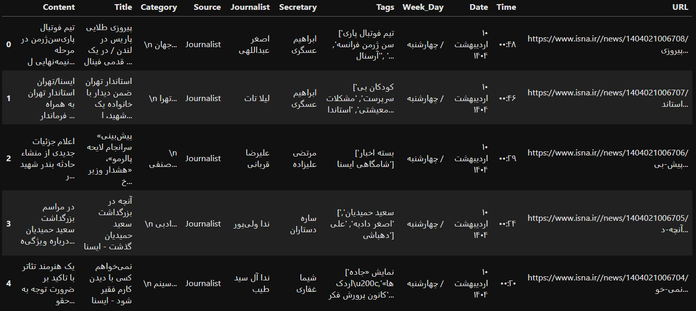
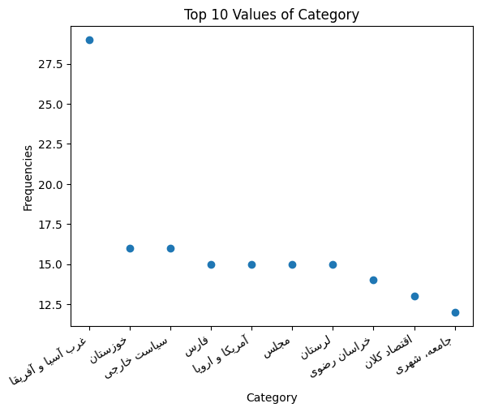
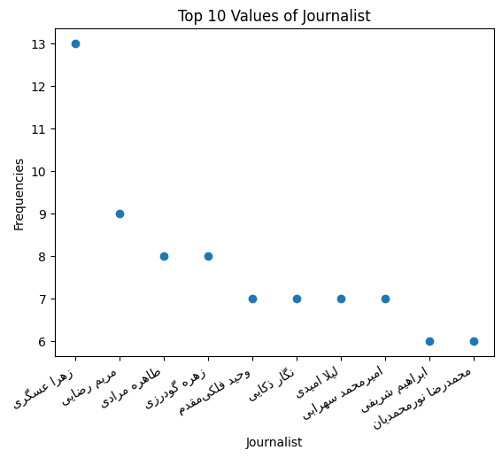
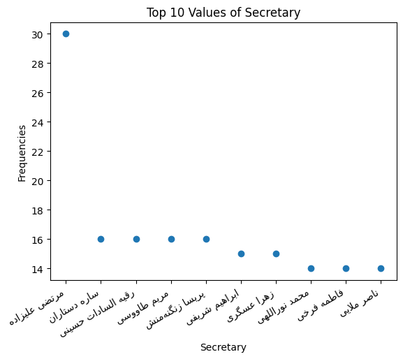
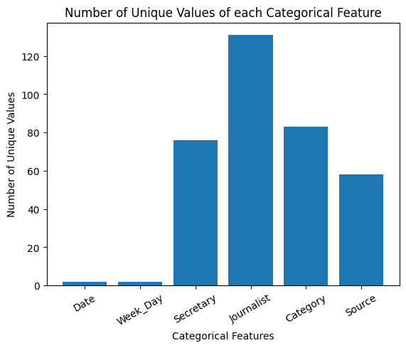

# ISNA-M

A small dataset of Persian-language news articles from the Iranian Students' News Agency (ISNA), with scripts for crawling, text preprocessing, exploratory analysis, and a baseline category-classification experiment.



## Dataset

This repository includes 534 news articles published between 23:36(+3:30 GMT) 09/02/1404 Jalali Calendar(29/04/2025) to 00:48(+3:30 GMT) 10/02/1404(30/04/2025).

| File | Description |
|---|---|
| `data/raw/Raw_ISNA_Dataset.csv` | Crawl, including article text, title, category, source, journalist, secretary, tags, publication date/time, weekday, and URL. |
| `data/processed/Clean_ISNA_Dataset.csv` | Preprocessed article content and category labels for text experiments. |

The raw file has 11 columns:
| Content | Title | Category | Source | Journalist | Secretary | Tags | Week_Day | Date | Time | URL |
|:---:|:---:|:---:|:---:|:---:|:---:|:---:|:---:|:---:|:---:|:---:|
| The content of each news article | The title of each news article | The category of each news article | The source of each news article; whether it is from an ISNA journalist or from an external source | The journalist of each news article; if available | Secretaries of each news article | Tags of each news article | The week day of the publication of each news article | The date of the publication of each news article | The time of the publication of each news article | The URL to each news article |
 
The processed file has two columns:
| Content | Category |
|---|---|
| Lists of each article's words after preprocessing | Categories of each article after preprocessing |


### Some statistics from the dataset:

| Measure | Raw text | Processed text |
|---|---:|---:|
| Types (# Unique Words) | 20,993 | 13,696 |
| Tokens (# All Words) | 224,540 | 167,118 |

## Quick start

Python 3.10 or newer is required. From the repository root:

```bash
python -m venv .venv
```

Activate the environment, then install the project and optional test dependency:

```bash
# macOS / Linux
source .venv/bin/activate

# Windows PowerShell
# .venv\Scripts\Activate.ps1

python -m pip install --upgrade pip
python -m pip install -e ".[dev]"
```

### 1. Crawl ISNA

```bash
isna-crawl --pages 2 --delay 2 --output data/raw/Raw_ISNA_Dataset.csv
```

The default is 18 archive pages with a two-second delay between requests. The crawl may take a while and may fail if ISNA changes its page structure. Please respect the website's policies and avoid sending excessive requests.

### 2. Clean and analyse the raw dataset

```bash
isna-clean
```

Defaults are repository-relative, so the command can be run from another working directory after installation. It reads `data/raw/Raw_ISNA_Dataset.csv`, writes `data/processed/Clean_ISNA_Dataset.csv`, and regenerates figures in `reports/figures/`.

Useful options:

```bash
isna-clean --input path/to/raw.csv --output path/to/clean.csv --figures path/to/figures
isna-clean --show-plots
```

The preprocessing pipeline cleans selected metadata fields, tokenizes Persian article text, removes the project's stop-word list, stems tokens with Parsivar, saves the processed dataset, and generates descriptive plots. It requires the dependencies installed by the project setup.

### 3. Run the category baseline

```bash
isna-train
```

The default run evaluates random forests with 10, 25, 50, 100, 500, and 1,000 estimators using a bag-of-words representation. Choose a smaller run while experimenting:

```bash
isna-train --estimators 10 25 --max-features 1000 --output reports/baseline-run.txt
```

The classifier uses the cleaned dataset by default. The evaluation reports and experiment summary should be interpreted in the context of a small dataset with many infrequent categories; they are a baseline, not evidence of production-ready classification performance.

## Exploratory figures

The figures are kept in `reports/figures/`:

### Word frequency and vocabulary growth


### Metadata distribution







## Project structure

```text
ISNA-M/
├── src/isna_m/
│   ├── crawler.py       # Fetch article metadata and content
│   ├── cleaner.py       # Persian text preprocessing and plots
│   ├── predictor.py     # Random-forest baseline experiment
│   └── paths.py         # Shared repository-relative paths
├── data/
│   ├── raw/             # Original CSV
│   └── processed/       # Preprocessed CSV
├── reports/
│   ├── figures/         # Plots
│   └── baseline-results.md
├── tests/
├── pyproject.toml
└── requirements.txt
```

More detail about module responsibilities and known limitations is in [`ARCHITECTURE.md`](ARCHITECTURE.md).

## Tests

```bash
python -m pytest
```

The tests cover parsing helpers, repository-relative paths, small cleaning utilities, and predictor input validation. They do not make network requests or run the full NLP pipeline.

## Notes and limitations

- The crawler depends on ISNA's current HTML tags and selectors, which may change.
- Re-running the cleaning pipeline requires Parsivar, Matplotlib, `arabic-reshaper`, and `python-bidi`.
- The dataset is small, and category frequencies are imbalanced. The baseline has limited predictive performance; see [`reports/baseline-results.md`](reports/baseline-results.md).