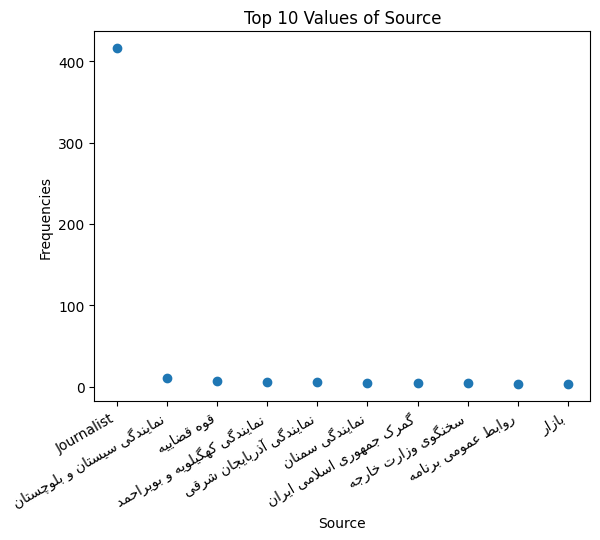

# ISNA-M
### A Small Dataset of Persian News Articles from ISNA News Agency.

.png)

This dataset includes 534 news articles published between 23:36(+3:30 GMT) 09/02/1404 Jalali Calendar(29/04/2025) to 00:48(+3:30 GMT) 10/02/1404(30/04/2025).

`Raw_ISNA_Dataset.csv` is collected by running `ISNA_crawler.py` and has 10 columns with the following description:
| Content | Title | Category | Source | Journalist | Secretary | Tags | Week_Day | Date | Time | URL |
|:---:|:---:|:---:|:---:|:---:|:---:|:---:|:---:|:---:|:---:|:---:|
| The content of each news article | The title of each news article | The category of each news article | The source of each news article; whether it is from an ISNA journalist or from an external source | The journalist of each news article; if available | Secretaries of each news article | Tags of each news article | The week day of the publication of each news article | The date of the publication of each news article | The time of the publication of each news article | The URL to each news article |

`Clean_ISNA_Dataset.csv` is obtained from `Raw_ISNA_Dataset.csv` by running `data_cleaner.py` and includes two columns:
| Content | Category |
|---|---|
| Lists of each article's words after preprocessing | Categories of each article after preprocessing |

## Some statistics of the dataset
| | `Raw_ISNA_Dataset.csv` | `Clean_ISNA_Dataset.csv` |
|---|---|---|
| Types (# Unique Words) | 20,993 | 13,696 |
| Tokens (# All Words) | 224,540 | 167,118 |

### Ranking of words against their frequencies in logscale(Zipf's Law)
.png) .png)

### Number of tokens against types(Heap's Law)
 

### Top 10 most frequent words
 

### Top 10 most frequent values of each feature
 
 

### Number of unique values of each feature

# `ISNA_crawler.py`
> [!WARNING]
> The html tags used in this code may not work as the ISNA website's source code may change.

Scrapes ISNA website and collects data using *requests, re* and *BeautifulSoup* libraries and stores the information as a CSV file via *pandas* library.
First, crawls on ISNA's archive page and collect news articles' URLs. Then, obtains the desired information via crawling each article's web page. 

# `data_cleaner.py`
Processes and analyses the `Raw_ISNA_Dataset.csv`, obtained from running `ISNA_crawler.py`, and stores processed contents and categories of each article to be used by `category_predictor.py` using *re, pandas, matplotlib* and [*parsivar*](https://github.com/ICTRC/Parsivar) libraries.

*Tags, Time, Date, Week_Day, Category* and *Title* features are processed. Content of each article is split into words and then, stop words removal and stemming are applied.
The above plots show some analyses that have been done on the data.

# `category_predictor.py`
*pandas, numpy* and *scikitlearn* libraries are used to train a random forest classifier on the `Clean_ISNA_Dataset.csv`, which contains *Content*(predictor) and *Category*(label) columns. Scikitlearn's `CountVectorizer` is used to create Bag Of Words from contents and `OneHotEncoder` is applied on 83 unique label values.
Data is divided into training and testing subsets with 0.4 test/train ratio. Classifiers with different `n_estimators` values(10, 25, 50, 100, 500 and 1000) are evaluated to find the best value.
|`n_estimators`|***| precision | recall | f1-score |
|:---:|:---:|:---:|:---:|:---:|
|10| micro avg | 0.80 | 0.09 | 0.17 |
|10| macro avg | 0.08 | 0.03 | 0.04 |
|10| weighted avg | 0.21 | 0.09 | 0.12 |
|10| samples avg |0.09 | 0.09 | 0.09 |
|***|***|***|***|***|
|25 |micro avg|0.74|0.09|0.17|
|25 | macro avg | 0.05|0.03|0.03|
|25 | weighted avg |0.18|0.09|0.11|
|25 | samples avg |0.09 | 0.09 | 0.09 |
|***|***|***|***|***|
| 50| micro avg |0.78|0.07|0.12|
|50| macro avg | 0.05  |    0.02 |0.03|
|50| weighted avg | 0.16|      0.07   |   0.09| 
|50| samples avg |0.07|      0.07|      0.07|
|***|***|***|***|***|
|100 | micro avg |0.71|      0.05|      0.09|
|100| macro avg | 0.04|      0.01|      0.02|
|100| weighted avg | 0.14|      0.05|      0.06|
|100| samples avg |0.05|      0.05|      0.05|
|***|***|***|***|***|
| 500 | micro avg |0.75  |    0.04 |     0.08 |
|500| macro avg |0.03 |     0.01  |    0.02|
|500| weighted avg |0.10|      0.04|      0.05|
|500| samples avg |0.04|      0.04|      0.04|
|***|***|***|***|***|
|1000| micro avg |0.77|      0.05|      0.09|
|1000| macro avg |0.04|      0.02|      0.02|
|1000| weighted avg |0.12|      0.05|      0.06 |
|1000| samples avg |0.05|      0.05|      0.05|

The above table is the summary of the outcome. It shows that the best value of the `n_estimators` is 10 and others overfit the data, which is not surprising due to the small amount of the dataset.

The poor results stem from:

1- **Small size of the dataset**. It only contains 167,118 words. This can be tackled by collecting or synthesising more data.

2- **Sparsity of the labels**. Many categories have appeared less than 5 times and may appear only in training or testing subsets after spliting the data. This can be tackled by:
- Collecting or synthesing more data from underrepresented labels.
- Ignoring labels appeared once and make sure each label's samples are present in both training and testing subsets.

3- **Not robust model**. Other hyperparameters should be evaluated through a systematic grid search to find the best setting. Also, various architectures should be tried to find the best solution.